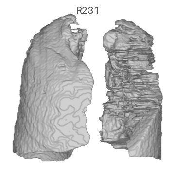
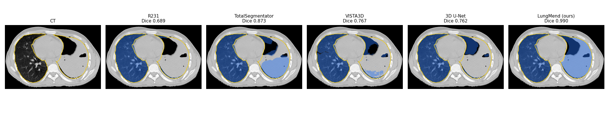

<p align="center">
  
</p>

<h1 align="center">LungMend</h1>

<p align="center">
<b>LungMend: a healthy-only latent diffusion shape prior for lung mask correction in severe tuberculosis CT</b><br>
ISBI 2027 submission
</p>

---

Lung segmentation models trained on mostly healthy scans (R231 from `lungmask`, TotalSegmentator, VISTA3D, ...) tend to
leave out exactly the parts of the lung that matter in severe tuberculosis: consolidations, cavities, collapsed lobes and
subpleural disease. LungMend takes such a mask and completes it.

It is a latent diffusion model trained **only on healthy lungs**. During training, healthy masks are damaged the way R231 fails
on diseased lungs (peripheral erosion, missing regions, cavity holes, hilar drops, leaks), and the model learns to recover the
healthy shape from the damaged mask and the patient's bones. At test time it never sees a lesion, only the R231 mask and a bone
mask, so it does not depend on what the disease looks like on CT.

The animation above is a severe TB patient from the Avicenne hospital: R231 (grey) misses a large part of the left lung,
and LungMend adds it back (green).

## How it works

- **Shape representation.** Lung masks are turned into signed distance maps (clipped at 20 mm) on a 128³ crop, and a 3D VAE
  compresses them to a 16³ × 8 latent.
- **Conditioning.** The denoiser (3D U-Net, v-prediction, cosine schedule) sees the latent of the R231 mask, the bone mask and
  a distance-to-bone map. The R231 latent is dropped 20 % of the time in training, which enables classifier-free guidance.
- **Inference.** 5 DDIM samples (50 steps, guidance 1.5) are decoded, their signed distance maps averaged, upsampled to the
  original resolution and thresholded at 0. About 20 s per scan on one GPU.

## Installation

```bash
git clone https://github.com/noureddinekhiati/LungMend.git
cd LungMend
pip install -r requirements.txt
```

Download the weights (`lungmend_weights.zip`, about 700 MB) from the
[Releases](../../releases) page and unzip it into `weights/`:

```
weights/lungmend_vae.pt
weights/lungmend_ldm.pt
```

## Usage

LungMend corrects an existing lung mask. Get the R231 mask first, for example with
[lungmask](https://github.com/JoHof/lungmask):

```bash
pip install lungmask
lungmask ct.nii.gz r231.nii.gz --modelname R231
```

Then:

```bash
python predict.py --lung r231.nii.gz --ct ct.nii.gz --out lungmend.nii.gz
```

The bone mask is computed from the CT (HU > 250 inside the body, scanner table removed). If you already have one, pass
`--bone bone.nii.gz` instead of `--ct`; `--save-bone` writes the one that was computed. The output is a binary mask on the
grid of the input mask.

| Option | Default | |
|---|---|---|
| `--samples` | 5 | number of diffusion samples averaged |
| `--guidance` | 1.5 | classifier-free guidance; lower values trust the R231 mask less |
| `--steps` | 50 | DDIM steps |
| `--seed` | 0 | seed of the first sample |
| `--layout` | `ras` | `ras` for any correctly oriented NIfTI; `zyx` for arrays already stored (z, y, x) on a ~0.6 mm grid |
| `--device` | auto | e.g. `cuda:1`, `cpu` |

Input volumes are reoriented and resampled to 0.6 mm internally, and the result is mapped back to the input grid.

From Python:

```python
import nibabel as nib
from lungmend import LungMend, bone_mask

model = LungMend("weights")
mask = model.predict(lung_zyx, bone_zyx)          # (z, y, x) binary arrays, apex first, anterior first, ~0.6 mm
mask, samples = model.predict(lung_zyx, bone_zyx, return_samples=True)   # samples: (5, 128, 128, 128) signed distances
```

The spread of the 5 samples is a useful uncertainty map: it is high where the model is unsure the lung extends.

## Results

Evaluation on 200 manually annotated axial slices from 20 severe ImageCLEF tuberculosis patients (10 slices per patient,
2D metrics at 0.6 mm). LungMend, Post-DAE and the 3D U-Net take the R231 mask as input; TotalSegmentator and VISTA3D work from the CT
alone (union of their five lobe labels).

| Method | Dice | ASD (mm) | HD95 (mm) | NSD@2mm | Precision | Recall | Cavity recall | Consolidation recall |
|---|---|---|---|---|---|---|---|---|
| R231 (lungmask) | 0.909 | 4.38 | 27.4 | 0.790 | 0.981 | 0.859 | 0.869 | 0.732 |
| R231 + 10 mm closing | 0.929 | 3.79 | 22.9 | 0.832 | 0.960 | 0.911 | 0.934 | 0.868 |
| TotalSegmentator (lobes) | 0.919 | 4.29 | 24.7 | 0.738 | 0.986 | 0.870 | 0.951 | 0.723 |
| VISTA3D (MONAI, lobes) | 0.847 | 7.61 | 38.8 | 0.572 | 0.990 | 0.754 | 0.726 | 0.364 |
| Post-DAE | 0.767 | 11.87 | 36.5 | 0.146 | 0.747 | 0.804 | 0.968 | 0.942 |
| 3D U-Net (R231 + bone + CT) | 0.932 | 4.04 | 22.1 | 0.824 | 0.983 | 0.899 | 0.957 | 0.791 |
| **LungMend (ours)** | **0.986** | **0.57** | **5.5** | **0.939** | 0.983 | **0.989** | **0.993** | **0.981** |

Cavity and consolidation recall: fraction of the DeepPulmoTB cavity (label 3) and consolidation (label 1) pixels, restricted to
the annotated lung, that the method includes in the lung.

<p align="center">
  
</p>
<p align="center"><sub>TRN_477, slice 190. Prediction in blue, manual annotation in yellow, Dice per method.
More cases in <a href="results/qualitative">results/qualitative</a>.</sub></p>

- `results/comparison_table.md`: the table above
- `results/per_slice_metrics.csv`: every metric for every method and slice
- `results/ablation_table.md`: ablation of the training components (representation, conditioning, corruptions) and of the
  inference steps
- `results/qualitative/`: R231, TotalSegmentator, VISTA3D, 3D U-Net and LungMend side by side on six slices

## Annotations

We release the 200 annotated slices used above (`annotations/`).

```
annotations/
  annotated_slices.csv          case, slice_k, z_mm, orig_slice, lung_px
  masks/<case>_annotation.nii.gz
```

**Files.** One NIfTI per patient, binary: 1 = lung, 0 = not lung. Only the 10 slices listed in `annotated_slices.csv` are
annotated; every other slice is empty and must be treated as *not annotated*, not as background.

**Geometry.** The masks are on a 0.6 mm isotropic grid in the same world frame as the original ImageCLEF / DeepPulmoTB
volumes (same origin and orientation), so they overlay the original CT directly in ITK-SNAP or 3D Slicer, or can be resampled
onto it with nearest neighbour. `slice_k` is the axial index in the annotation file, `z_mm` its position, and `orig_slice` the
nearest axial slice of the original CT.

**Protocol.** For each patient, the 10 slices were chosen where LungMend and R231 differ the most (lung area at least 30 % of
the patient's largest slice, slices at least 10 mm apart). The annotator started from the LungMend mask and corrected it slice by
slice in ITK-SNAP, with the CT shown at [-1000, 400] HU. Keep this in mind when reusing the slices: they focus on the regions
where R231 fails, and the starting point favours LungMend.

### Data legend

**ImageCLEF.** Chest CT of tuberculosis patients from the ImageCLEFmed Tuberculosis task; cases are named `TRN_xxx` as in the
challenge release. The CT volumes are not redistributed here; download them from ImageCLEF.

**DeepPulmoTB.** Lesion masks for the same ImageCLEF CTs, same file names and grid as the CT:

| Label | Meaning |
|---|---|
| 0 | outside the lung |
| 1 | consolidation |
| 2 | healthy lung |
| 3 | cavity |

Whole lung = label > 0 (cavities included). We use labels 1 and 3 for the consolidation and cavity recall above.

**Our annotation.**

| Value | Meaning |
|---|---|
| 1 | lung (aerated, consolidated or cavitated) |
| 0 | not lung, on annotated slices; nothing on the other slices |

## Repository layout

```
predict.py              command-line inference
lungmend/               model code (VAE, U-Net, diffusion, preprocessing, bone mask, NIfTI I/O)
weights/                put the downloaded weights here
training/               training code: dataset preparation, corruptions, VAE and diffusion training, configs
annotations/            the 200 annotated ImageCLEF slices
results/                tables, per-slice metrics, qualitative comparisons
assets/                 README images
```

## Training

The training code is in `training/`. It expects healthy CTs as `data/raw/<pid>/lung.nii.gz` (R231 mask) and
`data/raw/<pid>/thorax.nii.gz` (bone mask):

```bash
cd training
python prepare_dataset.py                                   # -> data/npy128, data/splits.json
torchrun --nproc_per_node=$NGPU train_vae.py --config configs/vae.yaml --run_dir runs/vae
python train_vae.py --config configs/vae.yaml --run_dir runs/vae --encode_all --ckpt runs/vae/ckpt/best.pt   # latent_stats.json
torchrun --nproc_per_node=$NGPU train_ldm.py --config configs/ldm_stage1.yaml --run_dir runs/ldm
torchrun --nproc_per_node=$NGPU train_ldm.py --config configs/ldm_stage2_medial.yaml --run_dir runs/ldm_medial \
    --corruption_medial --init_from runs/ldm/ckpt/last.pt
```

`train_vae.py` and `train_ldm.py` run a short check with `--debug` (2 patients, a few steps).

## Citation

```bibtex
@inproceedings{lungmend2027,
  title     = {LungMend: A Healthy-Only Latent Diffusion Shape Prior for Lung Mask Correction in Severe Tuberculosis CT},
  booktitle = {IEEE International Symposium on Biomedical Imaging (ISBI)},
  year      = {2027},
  note      = {Submitted}
}
```
